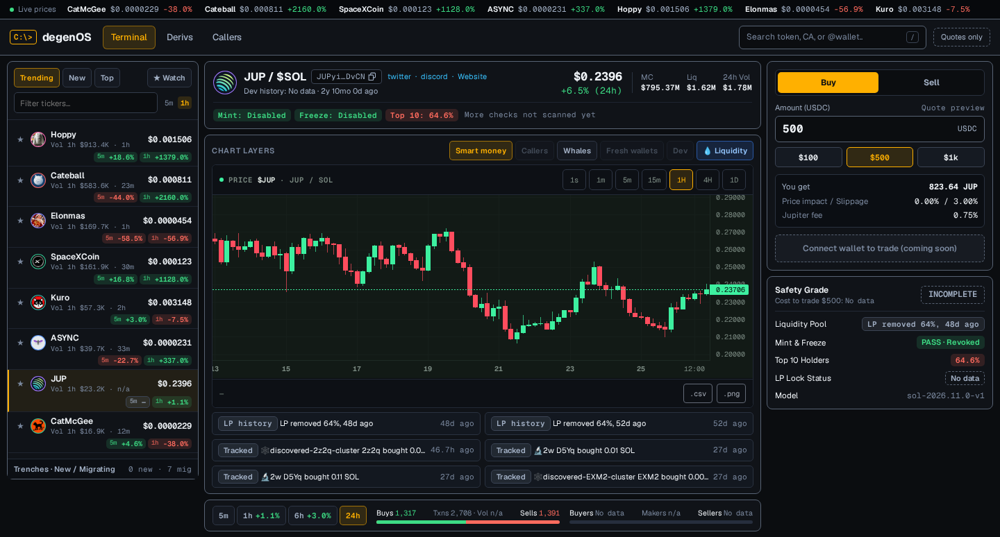

# degenOS

**Grade the wallet, not the hype.**

[Try the terminal](https://cockpit.degenos.ai/terminal)

degenOS is a read-only, Solana-first trading terminal. It grades tokens and wallets. You read the grade and the quote; you trade in your own wallet. degenOS never holds funds, never connects a wallet, and never places a trade.

The product is at [degenos.ai](https://degenos.ai).

## What it does today

- **Terminal** — a public, read-only cockpit for a token. Open it with [Try the terminal](https://cockpit.degenos.ai/terminal). It shows a chart, a Safety Grade, a quote-only trade panel, and wallet grades.
- **Chart** — candlesticks, with a price line when candles are unavailable. Candle data comes from GeckoTerminal and CoinGecko.
- **Safety Grade** — mint and freeze authority, top-10 holder concentration, and LP history, when those checks have been recorded. A mint that has not been graded is shown as incomplete, not as a pass.
- **Quote-only trade panel** — pick a size and side to see a quote. Wallet connect and trade execution are off.
- **Wallet grader** — grades a wallet on what a copier could have received after a delay, net of a modeled 0.75% platform fee per side plus 0.0035 SOL, and a measured (or fallback) round-trip cost. Coverage gates fail closed when the sample or the measured-cost share is too thin.
- **Callers board** — public caller receipts, so you can inspect the record behind a call.

On-chain reads use Alchemy RPC. The 0.75% platform fee is modeled in the grader; fee collection is not on.

## How grades work

Grades are models with priors, not guarantees, and they are not financial advice.

**Token Safety Grade** looks at on-chain facts: whether mint and freeze authority are revoked, how concentrated the top 10 holders are, and any recorded LP add/remove history. Missing data stays visible. Incomplete is not a pass.

**Wallet grades** ask a narrower question than whether the wallet itself made money: what would a later copier have received, after a delay, net of fees and friction? Entries use a delay floor and, when enough receipts exist, a measured lag. Buys with no usable forward price, and wallets whose coverage is too thin, fail closed instead of being filled in with optimistic assumptions. When a measured round-trip cost is missing, a conservative fallback is used, and a wallet is not treated as publishable if that fallback is carrying the result.

None of this predicts future returns. A high grade is not a buy signal, and a safety check that passes is not a claim the token is safe.

## In progress

These are not live yet:

- Tracked-wallet trade feed
- Conviction badge and exit alerts, which will warn you when the wallets it tracks start selling
- Access (Pass / Genesis), listed as coming soon on [degenos.ai](https://degenos.ai)

## Links

- Product: [degenos.ai](https://degenos.ai)
- [Try the terminal](https://cockpit.degenos.ai/terminal)
- X: [@degenOS_ai](https://x.com/degenOS_ai)

## Not financial advice

degenOS is a read-only terminal. It does not execute trades, hold assets, or connect a wallet. Grades and quotes are information, not advice. Trading new tokens is high risk; you can lose everything you put in.

## License

Released under the MIT License. See [LICENSE](LICENSE) for the full text.
